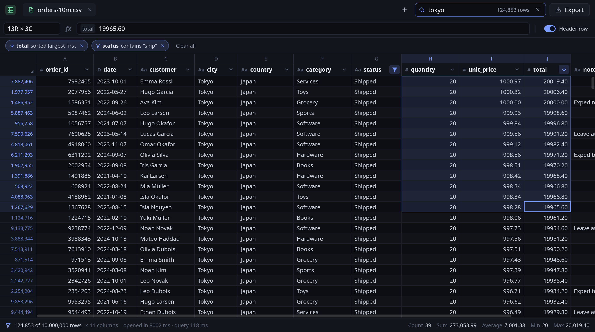
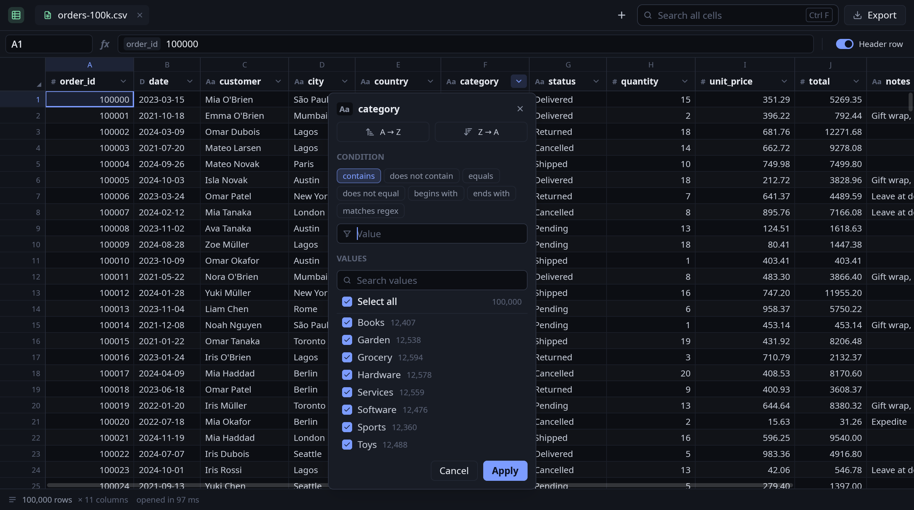
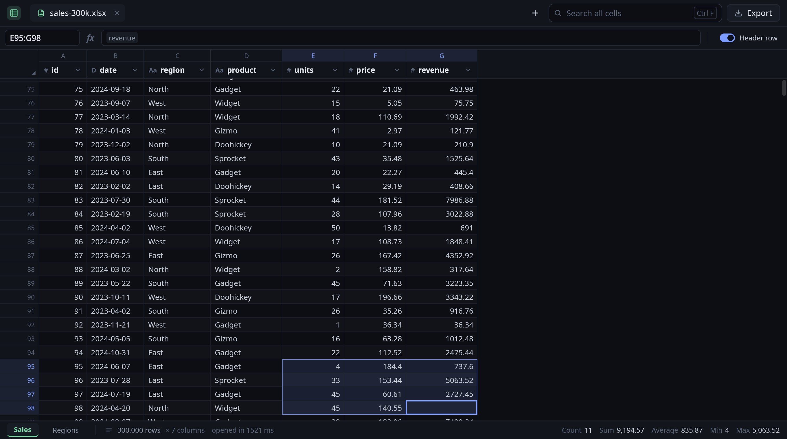

<p align="center">
  
</p>

<h1 align="center">Rowscope</h1>

<p align="center">
  A fast spreadsheet viewer and filter for CSV and Excel files with millions of rows.<br>
  Written in Rust on <a href="https://github.com/trevortomlin/gpui-fast">GPUI Fast</a>.
</p>

<p align="center">
  <a href="https://github.com/trevortomlin/rowscope/actions/workflows/ci.yml"></a>
  <a href="LICENSE"></a>
</p>

Spreadsheet apps stop at about a million rows and slow down well before that. Rowscope indexes a
10-million-row CSV in about a tenth of a second (once it's in the page cache; the first rows
show in milliseconds either way) and searches, filters and sorts it in milliseconds,
while keeping the familiar spreadsheet layout: column letters, a name box, a formula bar,
AutoFilter-style column menus and selection totals. It's a sibling of
[Disk Usage](https://github.com/trevortomlin/disk-usage-rs) and
[taskmanager-rs](https://github.com/trevortomlin/taskmanager-rs) and shares their look.







## Features

- **Formats.** CSV, TSV and other delimited text (the delimiter is sniffed: `,` `\t` `;` `|`),
  plus XLSX, XLSM, XLSB, XLS and ODS through calamine. Workbooks get sheet tabs at the bottom.
- **Millions of rows.** A CSV is memory-mapped and only its row offsets are kept (4 bytes per
  row); cells are parsed only when drawn, filtered or sorted. Rows are indexed on all cores
  using quote parity, with a strict fallback for files with stray quotes. The first screen
  appears in milliseconds while the rest indexes. XLSX and XLSB sheets are streamed cell by
  cell into a compact packed form, so no full in-memory `Range` is built.
- **One custom-painted grid.** Headers, row numbers, cells, selection and scrollbars are drawn
  by a single element that reads only the visible cells, so a frame costs the same at 10 rows
  or 100 million. Scroll positions are `f64`, so the end of a huge file is as precise as the
  start.
- **Search all cells** (Ctrl+F): case-insensitive, run in parallel over the raw bytes.
- **Column filters** like Excel's AutoFilter. Use the header's ▾ button or right-click the
  header to sort A→Z or Z→A, set a condition (contains, equals, begins/ends with, regex,
  `=` `≠` `>` `≥` `<` `≤` between), or tick values in a checklist with counts. The checklist
  only counts rows the other filters let through.
- **Filter chips** show every active filter and sort. Click a chip to edit it, or × to remove it.
- **Right-click a cell** to filter by its value, exclude it, sort by its column, or fit the
  column width.
- **Selection like a spreadsheet.** Click, drag, Shift+click; click a column or row header;
  Ctrl+A. The status bar shows Count, Sum, Average, Min and Max, computed in the background
  for big selections.
- **Name box and formula bar.** Type `B12`, `5000` or `A1:C10` to jump (Ctrl+G).
- **Editing.** Type over a cell, or press F2 or double-click. Paste blocks from other
  spreadsheets, Delete to clear cells, and Ctrl+Z / Ctrl+Y to undo and redo. Edits are kept
  on top of the file (shown in amber) and never written to the source.
- **Export** (Ctrl+S) writes the rows shown, filtered and sorted, with edits, to a new CSV.
  Unedited rows of a comma-separated source are copied byte for byte.
- Copy to the clipboard as TSV, resize columns (double-click an edge to autofit), zoom
  (Ctrl+= / Ctrl+-), a header-row toggle, several files in tabs, drag-and-drop, recent files.

## Performance

10,000,000 rows × 11 columns, 879 MB CSV, 8 threads, file in the page cache:

| | Time |
| --- | --- |
| First rows on screen | 11 ms |
| Whole file indexed | 112 ms (40 MB index) |
| Search all cells | 80 ms |
| Text filter (`city = Paris`) | 106 ms |
| Number filter (`total > 5000`, 4.2 M matches) | 310 ms |
| Search + filter + sort, together | 133 ms |
| Sort by number / by text | 0.50 s / 0.61 s |
| Distinct values of a column | 90 ms |
| Sum/avg/min/max over 30 M cells | 0.38 s |

A 300,000-row XLSX streams its first rows in 0.25 s and finishes in 1.5 s.

Reproduce:

```sh
./target/release/rowscope --bench gen /tmp/orders.csv 10000000
./target/release/rowscope --bench /tmp/orders.csv
```

## Building

Rowscope runs on Linux (Wayland or X11) and needs a recent stable Rust toolchain. On Debian or
Ubuntu, install the system libraries first:

```sh
sudo apt install build-essential pkg-config libfontconfig-dev libfreetype-dev libvulkan1 \
  libwayland-dev libx11-xcb-dev libxcb1-dev libxkbcommon-dev libxkbcommon-x11-dev libzstd-dev
```

Then:

```sh
cargo build --release
./target/release/rowscope                  # welcome screen
./target/release/rowscope data.csv b.xlsx  # open files in tabs
```

To add it to your application menu and "Open with" lists:

```sh
install -Dm755 target/release/rowscope ~/.local/bin/rowscope
install -Dm644 rowscope.desktop ~/.local/share/applications/rowscope.desktop
install -Dm644 assets/app/rowscope.svg ~/.local/share/icons/hicolor/scalable/apps/rowscope.svg
```

## Keyboard

| Key | Action |
| --- | --- |
| Arrows, `PgUp` `PgDn`, `Home` `End` | Move |
| `Ctrl`+arrows, `Ctrl+Home` / `Ctrl+End` | Jump to the edge / start / end |
| `Shift`+any of the above | Extend the selection |
| `Ctrl+A`, `Ctrl+Space`, `Shift+Space` | Select all / column / row |
| `Tab` / `Enter` | Move right / down |
| Typing, `F2`, double-click | Edit the cell (`Enter` saves, `Esc` cancels) |
| `Delete` | Clear cells |
| `Ctrl+C` / `Ctrl+X` / `Ctrl+V` | Copy / cut / paste (TSV) |
| `Ctrl+Z` / `Ctrl+Y` | Undo / redo |
| `Ctrl+F` | Search all cells |
| `Ctrl+G` | Go to a cell |
| `Ctrl+Shift+L` | Clear the search and filters |
| `Ctrl+Shift+H` | Toggle the header row |
| `Ctrl+O`, `Ctrl+S`, `Ctrl+W` | Open, export CSV, close tab |
| `Ctrl+Tab` | Next tab |
| `Ctrl+=` / `Ctrl+-` / `Ctrl+0` | Zoom |

## How it works

| Module | Role |
| --- | --- |
| `src/data/csv.rs` | Delimiter sniffing, the parallel quote-parity row index, the cell parser |
| `src/data/workbook.rs` | Streams workbook sheets into packed rows |
| `src/data/query.rs` | Search, filters, radix-style sorts, distinct values, statistics, export |
| `src/data/value.rs` | Number and date parsing, column type inference |
| `src/grid.rs` | The custom-painted grid element |
| `src/sheet.rs` | One open table: loading, the view, selection, editing, mouse and keys |
| `src/column_menu.rs` | The sort and filter menu on column headers |
| `src/app.rs` | The window: tabs, search, name box, filter chips, status bar |

Rows are kept in immutable chunks of 65,536 behind `Arc`s, so the UI and background jobs share
snapshots of the data while it is still loading. A filtered or sorted view is a list of row
numbers (4 bytes per row), and an unfiltered view costs nothing.

## Developing

```sh
cargo fmt --check && cargo clippy --all-targets -- -D warnings
cargo test --release
# Render the window offscreen to PNG (see src/snapshot.rs for options):
cargo run --release --features snapshot -- --snapshot out.png data.csv search=tokyo sort=9 desc menu=5
```

## License

[MIT](LICENSE) © Trevor Tomlin
